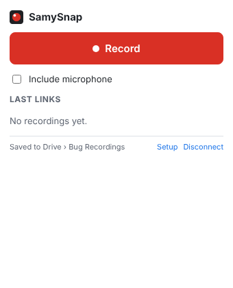
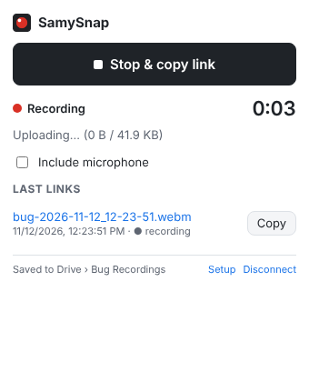
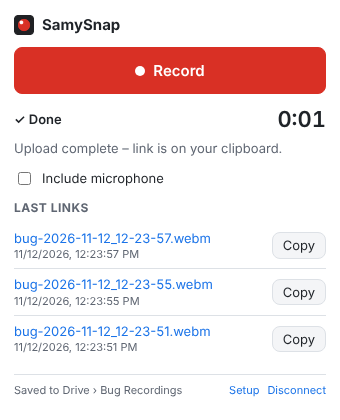

# SamySnap

A Chrome extension (Manifest V3) that records your **whole screen**, a window or a tab, and streams the video into **your Google Drive while you record**.
When you click **Stop**, a shareable Drive link is **already on your clipboard**, ready to paste into a bug ticket.

- A **built-in setup guide** that opens on install, with plain-language steps and Copy buttons. You paste your key; there's no file editing.
- One-time Google sign-in, using the least-privilege `drive.file` scope.
- 1080p / 30 fps, VP9 (falls back to VP8), about 4 Mbps, with optional tab or system audio plus microphone.
- Red **REC** badge, **Alt+Shift+R** shortcut, and a "Link copied to clipboard." notification.
- Videos are saved in Drive under **Bug Recordings** as `bug-YYYY-MM-DD_HH-mm-ss.webm`.
- Uploads retry with backoff and resume from the last received byte. If the upload really fails, you can **download the video locally**.

**→ Setup: [SETUP.md](SETUP.md)** · **Testing: [TESTING.md](TESTING.md)**

| Ready | Recording | Done |
|---|---|---|
|  |  |  |

## How the "instant link" works

```
Click Record
  ├─ Drive: files.create (metadata only) ──► fileId          ┐  runs in parallel
  │         permissions.create anyone/reader                  │  with Chrome's
  │         PATCH …/upload/drive/v3/files/<id>?uploadType=resumable ► session URI
  │         link = https://drive.google.com/file/d/<id>/view  ┘  screen picker
  └─ MediaRecorder.start(2000 ms)          ← only after BOTH are ready

Every 2 s: chunk → buffer → PUT session  "Content-Range: bytes a-b/*"  (multiples of 256 KiB, 308 expected)
           one request at a time; the remainder stays buffered

Click Stop
  1. copy link to clipboard   ← instantly, before anything else
  2. PUT the last bytes with  "Content-Range: bytes a-b/TOTAL"  → file complete
```

## Architecture

```
extension/
├── manifest.json        MV3; "key" (stable ID), oauth2 (drive.file), Alt+Shift+R command
├── background.js        Service worker. Owns the shared state (chrome.storage.session),
│                        badge, notifications, shortcut and link history. Copies the
│                        link on Stop via the offscreen document.
├── recorder/            Small extension window: screen picker → MediaRecorder →
│                        streaming upload. Minimizes itself while recording and closes
│                        itself when the upload is done.
├── offscreen/           Offscreen document (reason CLIPBOARD): textarea +
│                        execCommand('copy'), so copying works with the popup closed.
├── popup/               Setup / Connect / Record / Stop, timer, upload status, last 5 links, mic option.
├── setup/               Step-by-step setup guide (opens on install). Saves the pasted Client ID.
└── lib/
    ├── uploader.js      Resumable uploader: 256 KiB alignment, sequential queue,
    │                    308/Range handling, backoff, resume via "bytes */*".
    ├── drive.js         Folder cache, files.create, permissions.create, resumable session.
    ├── auth.js          Sign-in: launchWebAuthFlow with the pasted Client ID (token cached and
    │                    refreshed silently) or getAuthToken with a manifest client;
    │                    on 401: remove cached token, retry once.
    ├── media.js         Codec choice, 1080p30 constraints, Web Audio mixing (system audio + mic).
    └── filename.js, history.js, retry.js, messages.js, constants.js
```

### Why a recorder window and not the offscreen document?

`getDisplayMedia()` requires **transient user activation**: a click in the same document that calls it. An offscreen document can never receive a click, so the call fails there.
The popup can't do it either. The picker takes focus, Chrome closes the popup, and the stream dies with it.

So SamySnap opens a small **extension-owned window** that calls `chrome.desktopCapture.chooseDesktopMedia(['screen','window','tab','audio'])`. This is the same native Chrome picker (Entire screen / Window / Tab, plus "Share audio"), but it needs no extra click.
The window then opens the stream with `getUserMedia({chromeMediaSource:'desktop'})`.
Recording keeps going while the window is minimized.
The **offscreen document** is still used for the part it suits: copying to the clipboard when no UI is open.

## Known limitations

- **The file is incomplete until the final chunk arrives.** Anyone who opens the link in the first moments after Stop may see a partial file. Drive may also show *"video is still being processed"* for a short time after the upload completes. This is by design: the link is never delayed.
- **WebM files from MediaRecorder have no duration in the header.** Some players, including Drive's previewer at first, may show no duration or seek poorly. The file isn't post-processed before upload. Downloading it and remuxing with `ffmpeg -i in.webm -c copy out.webm` fixes this if you ever need to.
- **Keep the recorder window open** until the upload finishes. It may stay minimized. If you close it, you're asked to confirm, because closing it loses the recording.
- **Memory:** the full recording is kept in RAM until Drive confirms the upload, so it can be downloaded if the upload fails. That's about 30 MB per minute at 4 Mbps.
- **System audio for "Entire screen"** is supported by Chrome only on Windows and ChromeOS. Tab audio works everywhere. On macOS, Chrome also needs the Screen Recording permission.
- With an External app in **Testing** mode, Google asks you to reconnect about every 7 days. See [SETUP.md](SETUP.md#troubleshooting).

## Development

```bash
npm test             # unit + integration tests (no dependencies)
npm run test:e2e     # real Chromium end-to-end tests (Playwright, xvfb on Linux)
npm run extension-id # print the extension ID from manifest "key"
node scripts/screenshots.mjs   # regenerate docs/screenshots (needs a display)
```

The code is plain JavaScript ES modules with no build step and no runtime libraries.
