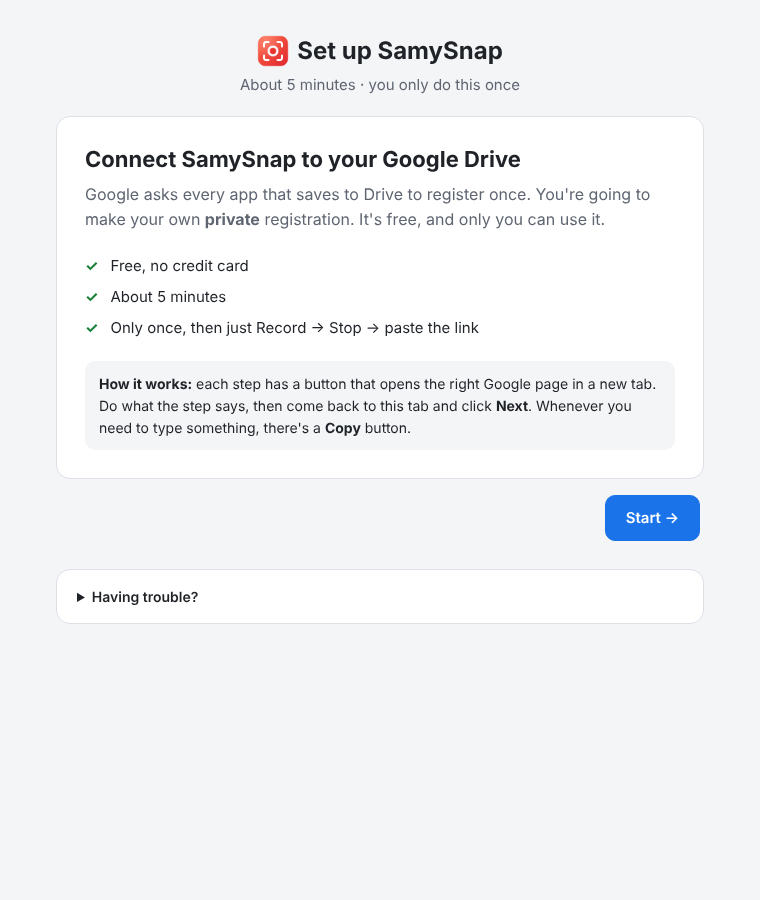
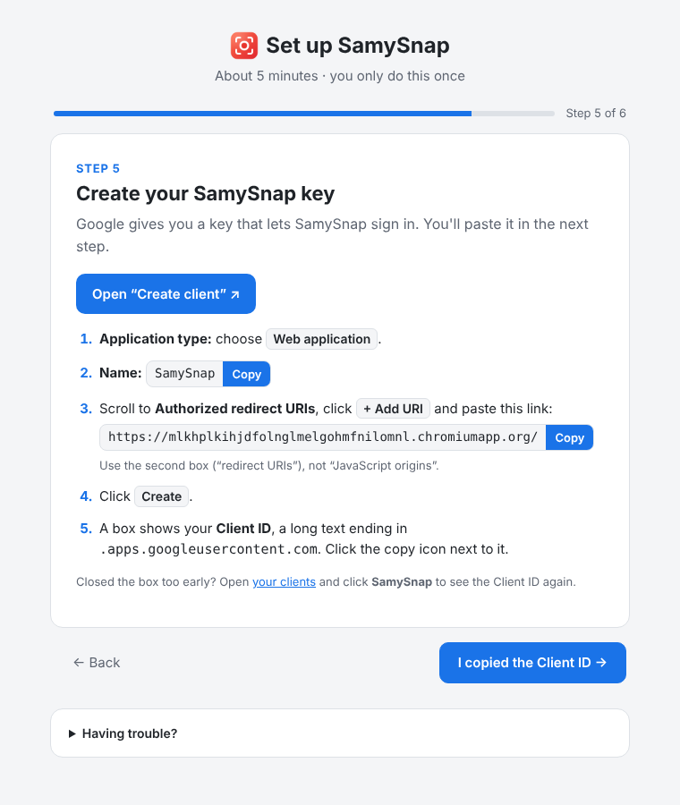
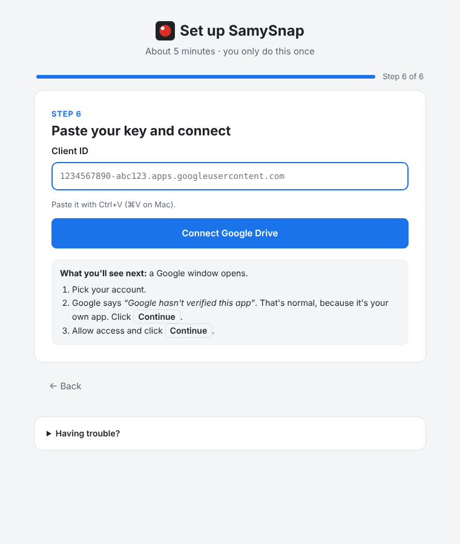

# SamySnap setup guide

## The easy way: the built-in guide

1. Open `chrome://extensions`, turn on **Developer mode** (top right), click **Load unpacked**, and select the **`extension`** folder inside this project. Select that folder itself, not the project root.
2. A **"Set up SamySnap"** tab opens by itself. If it doesn't, click the SamySnap icon and then **Start setup**.
3. Follow the 6 steps. Each one has a button that opens the right Google page, and Copy buttons for everything you need to paste.
   At the end, you paste your key into the guide and click **Connect Google Drive**. There's no file to edit.

| Welcome | A step | Paste and connect |
|---|---|---|
|  |  |  |

**Why is this needed?** Google only lets *registered* apps access Drive. Commercial extensions such as Loom did this once for all their users. Here, you're the app's owner, so you register it once yourself. It's free and private.

---

## Reference: the same steps in writing

The guide uses a Google OAuth client of type **Web application**, with this redirect link (shown with a Copy button in step 5):

```
https://mlkhplkihjdfolnglmelgohmfnilomnl.chromiumapp.org/
```

<details>
<summary>Advanced alternative: a "Chrome Extension" client in manifest.json</summary>

If you'd rather use Chrome's built-in sign-in (`chrome.identity.getAuthToken`):

1. Create an OAuth client of type **Chrome Extension** with Item ID `mlkhplkihjdfolnglmelgohmfnilomnl`.
2. Put its client ID in `extension/manifest.json` under `oauth2.client_id`.
3. Reload the extension.

If no key has been pasted in the guide, SamySnap uses this client automatically.
</details>

## Step 0: Get the code and check your extension ID

1. Download or clone this repository to your computer.
2. The extension's **ID** is fixed by the `"key"` field in `extension/manifest.json`. Google ties sign-in to this ID, which is why it must never change.
   The key that ships with the repo gives this ID:

   ```
   mlkhplkihjdfolnglmelgohmfnilomnl
   ```

   Write it down; you'll need it in Step 4. You can confirm it at any time with `npm run extension-id`, or by looking at the card on `chrome://extensions` after Step 6.

> **Optional: make your own key.** You may want an ID that nobody else has, for example because your copy of the repo is public.
> With [Node.js](https://nodejs.org) installed, run this in the project folder:
>
> ```bash
> node scripts/generate-key.mjs --force
> ```
>
> It writes a new `"key"` into `extension/manifest.json` and prints the new ID.
> It also saves the private key to `.keys/extension-key.pem`, which is git-ignored. Keep that file only if you'll ever pack a `.crx`.
>
> If you don't have Node.js, do the same with `openssl`:
>
> ```bash
> openssl genrsa 2048 > key.pem
> openssl rsa -in key.pem -pubout -outform DER | openssl base64 -A
> ```
>
> Paste the long string it prints into `manifest.json` as `"key": "<string>"`. Then load the extension (Step 6) and read the new ID from `chrome://extensions`.

---

## Step 1: Create a Google Cloud project

1. Open <https://console.cloud.google.com/> and sign in with your Google account.
2. Open the project picker at the top left of the page, next to the "Google Cloud" logo, and click **New project**.
3. Name it `SamySnap` and click **Create**.
4. When it's ready, make sure `SamySnap` is selected in the project picker.

## Step 2: Turn on the Google Drive API

1. Open <https://console.cloud.google.com/apis/library/drive.googleapis.com>.
2. Check that the `SamySnap` project is selected at the top, then click **Enable**.

## Step 3: Configure the OAuth consent screen

This is the screen Google shows when you click "Connect Google Drive".

1. Open <https://console.cloud.google.com/auth/overview>. In older consoles this is
   **APIs & Services → OAuth consent screen**. Click **Get started**.
2. **App information:** App name `SamySnap`. User support email: your Gmail. Click **Next**.
3. **Audience:** choose **External** and click **Next**.
4. **Contact information:** your Gmail. Click **Next**, accept the policy, then click **Create**.
5. Go to **Audience** in the left menu. Under **Test users**, click **Add users**, enter **your Gmail address**, and click **Save**.
   The publishing status stays **Testing**, which is what we want.
6. Go to **Data Access**, click **Add or remove scopes**, search for `drive.file` and tick
   `https://www.googleapis.com/auth/drive.file` ("See, edit, create and delete only the specific Google Drive files you use with this app").
   Click **Update**, then **Save**.

> SamySnap only uses `drive.file`. It can see **only the files it created** (the "Bug Recordings" folder and the videos), never the rest of your Drive.

## Step 4: Create the OAuth client

1. Go to **Clients** in the left menu (<https://console.cloud.google.com/auth/clients>). In older consoles this is **APIs & Services → Credentials → Create credentials → OAuth client ID**.
2. Click **Create client**.
3. **Application type:** choose **Web application**.
4. **Name:** `SamySnap`.
5. Under **Authorized redirect URIs**, click **+ Add URI** and paste `https://<your extension ID>.chromiumapp.org/`, for example
   `https://mlkhplkihjdfolnglmelgohmfnilomnl.chromiumapp.org/`.
6. Click **Create**. Copy the **Client ID**. It looks like
   `1234567890-abcdefg.apps.googleusercontent.com`.

## Step 5: Paste the client ID

Click the SamySnap icon, then **Setup**, then go to step 6 of the guide. Paste the client ID and click **Connect Google Drive**.

## Step 6: Load the extension in Chrome

1. Open `chrome://extensions` in Chrome.
2. Switch on **Developer mode** (top right).
3. Click **Load unpacked** and select the **`extension`** folder inside this project. Select that folder itself, not the project root.
4. SamySnap appears. **Check that the ID on its card matches** the one you used in Step 4.
   If it doesn't, the `"key"` in the manifest was changed. Fix the key, or update the Item ID of the OAuth client.
5. Click the puzzle-piece icon in the toolbar and **pin** SamySnap so its icon is always visible.

## Step 7: First run

1. Click the SamySnap icon, then **Connect Google Drive**.
2. Pick your Google account. Because the app is in Testing mode, Google warns that it "hasn't verified this app".
   Click **Continue**. This is expected for your own private app.
3. Allow access to "the specific Google Drive files you use with this app".
4. **macOS only:** the first time you record, macOS may ask to allow **Screen Recording** for Chrome.
   Allow it in **System Settings → Privacy & Security → Screen Recording**, then restart Chrome.
5. Click **Record**. A small SamySnap window opens with Chrome's picker. Choose **Entire screen**, a window or a tab, then click **Share**.
   The window minimizes itself and the icon shows a red **REC** badge.
6. Click the icon, then **Stop & copy link**, or press **Ctrl+Shift+9**. The link is on your clipboard at once.

### Keyboard shortcut

The defaults are **Ctrl+Shift+9** to start and stop recording, and **Ctrl+Shift+8** to pause (**⌘⇧9** and **⌘⇧8** on Mac). The popup shows the active shortcut at the top right. Click it to change shortcuts at `chrome://extensions/shortcuts`, which you'll also need to do if another extension already uses that key.

### Troubleshooting

| Symptom | Fix |
|---|---|
| "Error 400: redirect_uri_mismatch" | The redirect link in your OAuth client doesn't exactly match the one in step 5 of the guide. |
| "Error 401: invalid_client" | The pasted key is wrong. Copy the **Client ID** again (not the client secret). |
| "Access blocked: SamySnap has not completed the Google verification process" | Your Gmail is not in **Audience → Test users** (Step 3.5). |
| You're asked to reconnect after about 7 days | Google expires consent for apps in **Testing** mode after 7 days. To stop this, click **Publish app** under **Audience**. `drive.file` is a non-sensitive scope, so no Google review is needed. |
| "Public sharing is blocked…" warning | Your Google Workspace admin doesn't allow "anyone with the link" sharing. The link still works for people in your organization who have access. |
| Black or empty video on macOS | Allow Screen Recording for Chrome (Step 7.4) and restart Chrome. |
| No system sound in a full-screen recording | Chrome can capture system audio for the **entire screen** only on Windows and ChromeOS (tick "Share system audio"). On macOS and Linux, share a **tab** (tick "Share tab audio") or turn on the microphone. |
